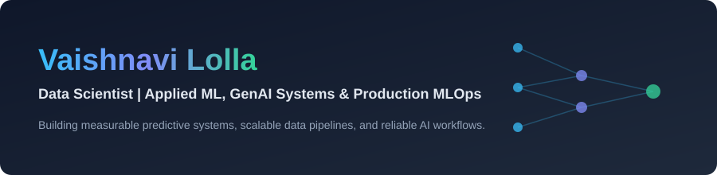

<div align="center">
  
</div>

> I design and ship end-to-end machine learning, predictive analytics, and Generative AI systems where model quality is judged by real operational outcomes rather than vanity offline scores. My work sits at the intersection of statistical modeling, scalable cloud data engineering, and production MLOps: turning noisy behavioral, transactional, and unstructured data into reliable decisions that hold up after deployment.

## Core Strengths and Focus Areas

<table>
<tr>
<td width="50%" valign="top">

**Applied ML, Forecasting &amp; Personalization**

* End-to-end recommendation engines combining collaborative filtering, content-based signals, and gradient-boosted ranking.
* Demand forecasting, customer behavioral feature engineering, anomaly detection, and risk classification with explainable SHAP attribution.
* Statistical hypothesis testing and rigorous offline-to-online validation to prevent leakage and metric illusions.

</td>
<td width="50%" valign="top">

**Generative AI, Data Pipelines &amp; Production MLOps**

* RAG and agentic workflows using LLMs, LangChain, LangGraph, Amazon Bedrock, and Pinecone vector search over large enterprise document corpora.
* Distributed batch and streaming data transformations across PySpark, Databricks, Snowflake, BigQuery, AWS Glue, Dataproc, Dataflow, and Kafka.
* Production deployment and monitoring with FastAPI, Docker, MLflow, Amazon SageMaker, and Vertex AI.

</td>
</tr>
</table>

## The Pivot Point

```text
2020 - 2023  Google (India)                 Data Scientist: BigQuery/GCP analytics, PySpark ETL, risk ML, NLP POCs, Vertex AI
2023 - 2025  Montclair State University     M.S. in Computer and Information Sciences: Explainable AI (SHAP), Kafka/Spark Streaming
2024 - Now   Amazon (USA)                   Data Scientist: E-commerce recommendations, demand forecasting, Bedrock/LangGraph RAG, MLOps
```

The arc moves deliberately from foundational analytics and distributed SQL/Spark engineering on GCP, through graduate depth in computer science and real-time systems, into owning end-to-end e-commerce ML, GenAI retrieval, and production monitoring on AWS and Snowflake.

## Tech Stack by Depth

Yardstick: **Production** = shipped, tuned, and debugged in enterprise workloads; **Applied** = built end-to-end POCs or graduate systems; **Working** = used in targeted workflows and cross-cloud integrations.

| Domain | Technologies | Depth | Level | Resume-Grounded Evidence |
| --- | --- | --- | --- | --- |
| Core Languages | Python, SQL, R, Scala | `██████████` | Production | Daily modeling, SQL warehouse optimization, and Spark/R analytics |
| Classical ML &amp; Stats | Scikit-learn, XGBoost, Random Forest, Time-Series, SHAP | `█████████░` | Production | Recommendation relevance lift (+18%), risk prediction (+16%), demand forecasting |
| Data Engineering | PySpark, Apache Spark, Databricks, Snowflake, BigQuery, AWS Glue | `█████████░` | Production | Cut distributed pipeline runtime from 4h to 2.5h and SQL queries from 12m to 8m |
| MLOps &amp; Serving | MLflow, Docker, FastAPI, Amazon SageMaker, Vertex AI | `████████░░` | Production | End-to-end model deployment, experiment tracking, and drift/quality monitoring |
| Generative AI &amp; NLP | LLMs, RAG, LangChain, LangGraph, Prompt Engineering, Bedrock, Pinecone, TensorFlow | `████████░░` | Applied | Contextual RAG retrieval across 30K+ documents and TensorFlow NLP classification |
| Cloud &amp; Streaming | AWS (S3, Glue, SageMaker), GCP (BigQuery, Dataproc, Dataflow), Azure, Kafka, Spark Streaming | `████████░░` | Applied | Multi-cloud enterprise pipelines plus real-time Kafka/Spark traffic forecasting |
| Analytics &amp; BI | Power BI, Tableau | `████████░░` | Production | Executive KPI dashboards cutting manual reporting effort by 15% |

## Building Blocks

<div align="center">


</div>

## Engineering Principles

<table>
<tr>
<td width="33%" valign="top">

**1. Measure Before Claiming**

Every model decision, threshold, and pipeline optimization should carry a reproducible number tied to business cost, statistical power, or operational exposure.

</td>
<td width="33%" valign="top">

**2. Name the Trade-Off**

Symmetric metrics hide asymmetric losses, tight watermarks trade completeness for memory, and small eval sets trade speed for blindness. Explicit boundaries beat silent assumptions.

</td>
<td width="33%" valign="top">

**3. Reproducible by Default**

Clean interfaces, deterministic data fixtures, automated verification, and clear architecture decision records make ML systems maintainable long after the first deployment.

</td>
</tr>
</table>

## Education and Connect

* **Master of Science in Computer and Information Sciences**, Montclair State University, Montclair, New Jersey (August 2023 - May 2025)
* **Email:** [Vaishnavilolla@mycvcareer.com](mailto:Vaishnavilolla@mycvcareer.com)
* **LinkedIn:** [linkedin.com/in/vaishnavi-lolla-1381141a3](https://www.linkedin.com/in/vaishnavi-lolla-1381141a3/)
